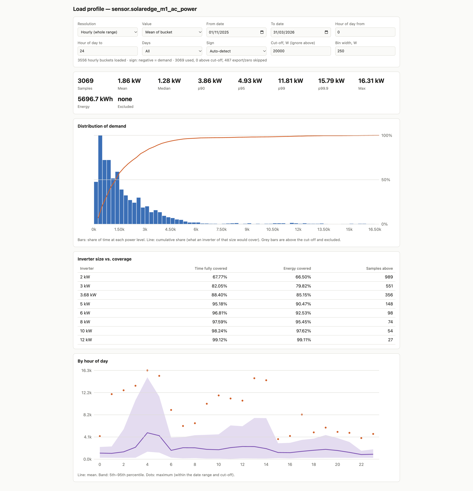

# ha-energy

Look at a Home Assistant power sensor (default: SolarEdge `M1 AC Power`) as a load profile, to size a
battery inverter: histogram of demand, percentiles, and how much time/energy an inverter of a given
size would cover. Car-charging spikes can be cut off.

Two parts, no dependencies beyond Node 24 (for `process.loadEnvFile` and the built-in `WebSocket`):

- `fetch.mjs` pulls long-term statistics from Home Assistant and writes `data.js`.
- `index.html` is a local page that reads `data.js`. Open it straight from disk; nothing is sent anywhere.



## Setup

Create `.env` beside `fetch.mjs`:

```
HA_TOKEN=<long-lived access token>
# HA_URL=http://192.168.2.118:8123      # optional; this is the default
```

Make the token in Home Assistant under your profile → Security → Long-lived access tokens.
Variables already set in the shell win over the file. Keep `.env` out of any repository.

## Fetching data

```bash
node fetch.mjs [--from YYYY-MM-DD] [--to YYYY-MM-DD] [--days N] [--entity sensor.x] [--minus sensor.y]
```

| Flags | Window |
|---|---|
| `--days N` | the N days up to now |
| `--from D` | D up to now |
| `--from D --days N` | N days forward from D |
| `--to D --days N` | N days back from the end of D (`--to` includes that whole day) |
| `--from D --to D` | exactly that |
| none | 35 days up to now |

Dates are local time. Giving `--from`, `--to` and `--days` together is an error. A window ending in
the future is cut off at now. The entity can also be given as a bare argument.

```bash
node fetch.mjs                                      # last 35 days
node fetch.mjs --days 30
node fetch.mjs --from 2025-11-01 --to 2025-11-30    # same month last year
node fetch.mjs --to 2025-11-30 --days 30            # same thing
```

`--minus` subtracts a second power sensor bucket by bucket, to get a load that has no sensor of its own.
The M1 meter only sees the grid, so true house load is PV production minus the (negative-when-importing)
meter. Both sensors are requested in W, because the inverter's `AC Power` is in kW and the meter's in W:

```bash
node fetch.mjs --entity sensor.solaredge_ac_power --minus sensor.solaredge_m1_ac_power --from 2025-11-08 --to 2026-03-31
```

Means subtract exactly; a bucket's min and max cannot, so they become bounds (max = a.max − b.min) and
*Max of bucket* overstates peaks. For data from 2026-11-08 onward there is a ready-made sensor, see
[House load sensor](#house-load-sensor); past winters need `--minus`.

Each run overwrites `data.js`. Copy it aside if you want to keep one window while fetching another.

### House load sensor

A Home Assistant Template Helper, **`sensor.house_power`** ("House Power"), was created on **2026-11-08**.
It is true house load in W: PV production + grid import − grid export.

```
{{ states('sensor.solaredge_ac_power') | float * 1000 - states('sensor.solaredge_m1_ac_power') | float }}
```

(`solaredge_ac_power` is in kW, the M1 meter in W, hence the `* 1000`.) It has device class power and state
class measurement, so HA keeps hourly mean/min/max statistics for it. Because it is a real sensor, its min
and max are exact, unlike `--minus`. It records only from 2026-11-08, so the 2026/27 winter and later can
be fetched directly, with no `--minus`:

```bash
node fetch.mjs --entity sensor.house_power --from 2026-11-08 --to 2027-03-31
```

Edit it under Settings → Devices & Services → Helpers. If it goes missing, recreate it with the template
above. Before 2026-11-08, use `--minus` instead.

### Resolution

Home Assistant keeps **5-minute** statistics for only about 10 days (the recorder purge setting) and
**hourly** ones indefinitely. The fetch stores both; anything older than ~10 days is hourly only.
Every bucket carries mean, min and max. An hourly mean smooths out short peaks, so for sizing an
inverter on old data use the page's *Max of bucket* option.

## Using the page

```bash
open index.html
```

| Control | Meaning |
|---|---|
| Resolution | 5 min (recent days only) or hourly (whole range) |
| Value | mean of each bucket, or its max (peaks) |
| From / To date | date range within the fetched data |
| Hour of day from / to | time-of-day window. `from` greater than `to` wraps midnight, e.g. `17` → `7` for an evening/night battery |
| Days | all, weekdays, or weekends |
| Sign | which sign means demand. Auto-detect uses the 00:00–05:00 median: night load is always consumption |
| Cut-off (W) | samples above this are ignored, e.g. car charging. They show grey on the histogram and are counted |
| Bin width (W) | histogram bin size |

Settings are remembered in the browser. The page shows:

- **Cards** — sample count, mean, median, p90/p95/p99/p99.9, max, energy.
- **Histogram** — share of time at each power level, with a cumulative line.
- **Inverter size vs. coverage** — for 2–12 kW: share of time fully covered and share of energy covered.
- **By hour of day** — mean, 5th–95th percentile band and maximum per hour.
- **Daily energy use (24 h)** — histogram of kWh per day with a cumulative line, plus mean/median/p90/p95/max.
  For sizing storage over winter. Built from hourly means over whole local days, so the resolution,
  value and hour-of-day settings do not apply; date range, weekdays/weekends, sign and cut-off do.
  Days with missing hours are skipped and reported. *Daily bin width* sets the bar size.
- **Battery size vs. days covered** — for 5–60 kWh usable: share of days that fit, how many do not,
  and the longest run of consecutive days that do not (a battery that covers 90% of days still fails
  if the bad days come in a row).

## Reading the results

- The M1 meter sits at the grid connection, so it shows grid import, not house load. While PV is
  producing, daytime load is understated. For a battery that discharges in the evening and at night
  this does not matter; set the hour window to the hours it would actually discharge.
- Samples that are zero or export (the other sign) are skipped and counted, not treated as zero demand.
- A car charge shows up as its own bump in the histogram. Put the cut-off in the gap between it and
  normal load. In 5-minute data a charge's first and last buckets can be partial and slip under the
  cut-off; the effect is small.
- The cut-off applies to the daily totals too: hours above it are left out of that day. That removes
  car charging, but would also drop a heat-pump hour above the cut-off, so raise it (or set it very
  high) when sizing for heating, and check the note under the daily chart for how many days are affected.
- This is a statement about past load, not a recommendation for a particular product.
